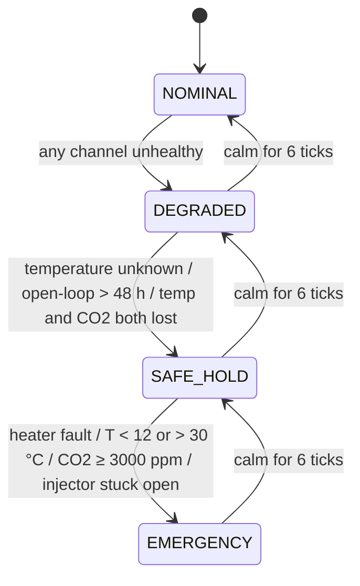

# Sensor safety and fail-safe protocols

Branch: `sensor-safety-failsafe`

This branch adds the requirements and protocols that keep the Mars lettuce greenhouse safe when a sensor or actuator fails. It contains three things:

1. **Research.** A hazard analysis and a set of sensor safety requirements, built from the CSCI 513 (Autonomous CPS, Fall 2026) lectures on requirements, temporal logic, verification and hybrid systems.
2. **Implementation.** An STL runtime monitor, the requirements written as executable STL, a sensor plausibility checker, and a fail-safe supervisor with six protocols.
3. **Evidence.** Unit tests, 17 closed-loop fault scenarios, and a falsification search that tries to break the requirements.

The full specification (hazards, every requirement, every protocol, results) is in [`../sensor_safety_requirements.md`](../sensor_safety_requirements.md). This README summarizes it and explains how to use the code.

---

## Contents

- [Why this was needed](#why-this-was-needed)
- [Research: from the course to this system](#research-from-the-course-to-this-system)
- [Architecture](#architecture)
- [The requirements](#the-requirements)
- [The fail-safe supervisor](#the-fail-safe-supervisor)
- [Results](#results)
- [Findings and open items](#findings-and-open-items)
- [How to run it](#how-to-run-it)
- [Using it in your own runs](#using-it-in-your-own-runs)
- [Files](#files)
- [Limitations](#limitations)

---

## Why this was needed

Before this branch, the project could already **detect** many faults. `AtmosphereTemperatureMonitor`, `SlowChannelMonitor` and `RootZoneMonitor` flag dropout, stuck, bias and drift faults and produce fused estimates. Nothing **acted** on those flags, and nothing stated what "safe" meant in a form that could be checked.

The baseline runs (the same controllers with no fail-safe) show what that costs:

| Fault | What happened without a fail-safe |
|---|---|
| Heater burnout at night | Burnout was detected within an hour, but nothing replaced the heat. The cabin fell to **−31.5 °C** (crop survival limit: 7 °C). |
| CO2 sensor dropout | The CO2 controller stopped injecting. The crop drew the cabin down to **0 ppm**. |
| CO2 sensor reading 400 ppm low | The controller over-injected to **1586 ppm**. |
| Pressure sensor +5 kPa | The CO2 estimate was scaled wrongly, so injection went ahead on an untrusted reading. |

The repo's own `tests/test_fault_requirements.py` listed heater-burnout survival as an open problem (an expected-failure test). It now passes.

---

## Research: from the course to this system

I read the six decks on the course schedule (https://jdeshmukh.github.io/teaching/cs513-autocps-fall-2026/schedule.html) that cover safety: Models of Computation, Dynamical/Hybrid Systems, Requirements and LTL, STL and Testing, Verification I, and Verification II. Each idea below maps to a specific part of this branch.

### Requirements (lecture 6: Safety Requirements and LTL)

- **Requirements are separate from design.** A requirement says *what* must hold, and the design says *how*. Section 4 of the spec lists requirements. Section 5 lists the protocols that meet them, and each requirement names the protocol that discharges it.
- **Kinds of requirement.** *Hard safety* (nothing bad ever happens), *hard liveness* (something good eventually happens), *soft performance*, and *security* (a non-behavioural requirement). Every requirement here carries one of these labels.
- **Granularity.** System, subsystem, function and timing levels. For example, "cabin stays between 7 and 32 °C" is system level, and "a dropout is flagged within 1 tick" is timing level.

### Signal Temporal Logic (lecture 7)

- **STL over real-valued signals.** Bounded operators: always `G[a,b]`, eventually `F[a,b]`, until `U[a,b]`.
- **Quantitative semantics.** Robustness ρ is the distance to violation: ρ > 0 means satisfied and ρ < 0 means violated. `safety/stl.py` implements the recursive robustness definitions in discrete time (1 tick = 1 hour).
- **Finite traces.** Testing always works on a bounded horizon, so the library uses explicit conventions: an empty window gives +∞ for `G` and −∞ for `F`. A missing value counts as −∞, which means an unknown value is treated as unsafe.

### Testing and falsification (lecture 7)

- **Input/output properties.** A requirement is a pair: a pre-condition on the inputs and a post-condition on the outputs. Detection requirements carry a pre-condition: they cover only faults large enough to be told apart from sensor noise (for example, a temperature bias of at least 2 °C).
- **Requirements-based testing.** A test suite of chosen input signals (here, fault schedules), each checked against every requirement.
- **Falsification.** Give the inputs a finite parameterization, simulate, score the run by robustness, and search for ρ < 0 using random search and then stochastic local search. `scripts/sensor_safety_check.py` does exactly this.

### Verification I (lecture 8)

- **Safety means staying in the good states.** Invariants and inductive invariants: initial states are good, and every step from a good state stays good.
- **Runtime monitoring.** A runtime monitor gives a verdict from a finite prefix of the trace. `OnlineMonitor` is that monitor. A verdict that depends on future ticks is held until the window closes.

### Verification II (lecture 10)

- **Barrier certificates.** A barrier certificate is a safety invariant for continuous dynamics: an "invisible barrier" that trajectories cannot cross. The emergency heating law uses a *discrete-time control barrier function* built on the habitat's own thermal model.
- **Over-approximation is sound for verification.** The barrier uses the *coldest* exterior temperature over the coming tick, so it covers the whole step and not only its start.

### Hybrid systems (lecture 3: Dynamical Systems)

- **Hybrid automata.** Discrete modes with guards, on top of continuous dynamics. The fail-safe supervisor is a four-mode hybrid automaton.
- **Zeno behaviour.** Infinitely many switches in finite time is a modelling defect. A minimum dwell time before stepping down to a less severe mode means that cannot happen, and a test checks it with a flickering fault flag.

### The plant facts the design is built on

From the code already in the repo:

- **Thermal model** (`thermal/model.py`): C = 1,771,225 J/K; UA = 14 W/K; 90 % of lamp power becomes heat. The exterior swings from −120 °C to +20 °C over a 24.65 h sol.
- **Actuator delay:** commands act one tick later, because BioSim reports the previous tick.
- **Lamps as backup heat:** the lamps can draw 15.2 kW, while the worst-case hull loss is about 2 kW. That headroom is what makes lamp backup heating feasible.
- **Exact power readings:** commanded and drawn heater power are both known exactly. A heater losing output can therefore be caught at a 5 % loss.

---

## Architecture

```
            truth (plant state, never seen by controllers)
              │
   ┌──────────▼───────────┐
   │ AtmosphereSensorLayer │  lag, noise, injected sensor faults
   └──────────┬───────────┘
   ┌──────────▼───────────┐
   │ Model-based monitor   │  fault labels (temp_faults, co2_faults, ...)
   │ (MonitorInLoop)       │  fused estimates (fused_temp_C, fused_co2_ppm)
   └──────────┬───────────┘
              │ obs
   ┌──────────▼───────────┐
   │ Controllers           │  HVAC PID, irrigation, CO2 hold (unchanged)
   └──────────┬───────────┘
              │ proposed commands
   ┌──────────▼───────────────────────────────┐
   │ FailSafeSupervisor            (this branch) │
   │  SensorGuard → mode automaton → P1..P6     │
   └──────────┬───────────────────────────────┘
              │ certified commands
   ┌──────────▼───────────┐
   │ Actuator layer        │  injected actuator faults
   └──────────┬───────────┘
              ▼
            plant ── log ──► safety.requirements.evaluate()  (STL robustness per requirement)
```

The supervisor runs *inside* `MonitorInLoop`, as its `inner_supervisor`. That way the monitor's prediction model steps forward with the commands that were actually sent, including fail-safe overrides. Without this, the monitor would mispredict the cabin temperature and blame healthy sensors.

---

## The requirements

All requirements are executable STL in `safety/requirements.py`. They are evaluated on a log, using **truth** for the physical quantities and the supervisor's history for modes and health.

| ID | Kind | Requirement | STL (ticks = hours) |
|---|---|---|---|
| SSR-01 | hard safety | Cabin temperature in the crop survival band | `G (7 ≤ T ≤ 32)` |
| SSR-02 | hard safety | CO2 below the exposure ceiling | `G (CO2 ≤ 5000)` |
| SSR-03 | hard safety | O2 and pressure habitable | `G (0.195 ≤ O2 ≤ 0.235 ∧ P ≥ 65)` |
| SSR-04 | hard safety | Battery keeps the life-support reserve | `G (E ≥ 10 kWh)` |
| SSR-05 | hard safety | Root-zone reservoir never dry once primed | `F[0,24] rz ≥ 2 ∧ G[24,T] rz ≥ 2` |
| SSR-10..14 | hard liveness, timing | A sensor fault on each channel is flagged in time | `G (fault → F[0,d] flag)`; d = 1 / 4 / 6 / 24 ticks for dropout / stuck / bias / drift |
| SSR-20 | soft | No false alarms on a healthy run | `G ¬flag` |
| SSR-21 | hard safety, timing | An unhealthy sensor takes the supervisor out of NOMINAL within 1 tick | `G (flag → F[0,1] mode ≥ DEGRADED)` |
| SSR-22 | hard safety | No CO2 injection beyond replacement on an untrusted reading | `G (co2_untrusted → u_co2 ≤ uptake)` |
| SSR-23 | hard liveness | Heater fault: back above 15 °C within 2 h, held for 6 h | `G (heater_fault → F[0,2] G[0,6] T ≥ 15)` |
| SSR-24 | security | Every command is finite and within its range | `G (u_min ≤ u ≤ u_max)` |
| SSR-25 | hard liveness | Back to NOMINAL within 30 h after faults clear, unless a new fault starts | `G (cleared → F[0,30] (nominal ∨ fault))` |
| SSR-30 | soft | Growth band while fault-free | `G (fault ∨ 18 ≤ T ≤ 25)` |
| HSR-01 | hardware | Independent normally-closed isolation valve on the CO2 injector | from finding F-1 |
| HSR-02 | hardware / configuration | Heater output loss of 5 % or more is flagged | from finding F-2 |

The detection requirements (SSR-10..14) cover only faults above a minimum size: 2 °C, 150 ppm, 0.01 O2 fraction, 2 kPa or 2 L for a bias, with matching per-tick limits for drift. Smaller faults are within sensor and model noise. They are tolerated, and the system-level requirements still bound their effect.

---

## The fail-safe supervisor

### SensorGuard: is this reading believable?

A channel is **healthy** only if all five checks pass:

1. **Present and numeric.** Not missing, NaN or ∞.
2. **Physically possible.** Inside the range the measurand can take. This is not the alarm band.
3. **Physically reachable.** The change since the last plausible reading is within what the physics allows over that many ticks. A single spike costs one tick, and a real step change is accepted again.
4. **Not flagged by a monitor.** No model-based monitor has labelled the channel.
5. **Not stale.** It has not been unhealthy for longer than `stale_ticks`.

The guard keeps a last-known-good value and its age for each channel.

### Mode automaton



- **Going up is immediate.** The supervisor jumps straight to the most severe mode whose guard is true.
- **Coming down is slow.** It drops one level at a time, and only after 6 consecutive calm ticks. This dwell time rules out Zeno behaviour and stops actuators from chattering.

### Protocols

| | When | What it does |
|---|---|---|
| **P1 Substitute** | DEGRADED+ | Controllers use the monitor's fused or model estimate. The supervisor records the reason, the last-known-good value and its age. |
| **P2 CO2 hold** | always | If the CO2 or pressure reading is untrusted, it injects exactly what the crop took up last tick. That cannot raise the concentration and does not starve the crop. Hard interlock at 2000 ppm. It commands the injector to zero if the injector is stuck open. |
| **P3 Safe hold** | SAFE_HOLD | The heater is clamped to ±150 W around the model's hull-loss feedforward, so a wrong estimate can neither run the heater away nor freeze the cabin. |
| **P4 Backup heat** | EMERGENCY (cold) | The lamps become the heater, sized by the barrier function below. A failed heater keeps a 600 W probe current so the fault stays observable, and so a recovered heater shows up again. |
| **P5 Overheat** | EMERGENCY (hot) | Heater off; lamps capped at what the hull can shed. |
| **P6 Sanitize** | always, last | Every command is clipped into its schema range; NaN or ∞ becomes the safe minimum. |

### Emergency heat as a control barrier function

Using the exact one-tick solution of the thermal ODE:

```
T+ = T_eq + (T − T_eq)·d,   d = exp(−UA·Δt / C),   T_eq = T_ext + Q/UA
h(T) = T − T_floor,         require  h(T+) ≥ (1 − γ)·h(T)
⇒  Q ≥ UA · [ (T_floor + (1−γ)(T − T_floor) − d·T) / (1 − d)  −  T_ext,worst ]
```

The parameters are T_floor = 16 °C and γ = 0.5. Above the floor, the set {T ≥ 16 °C} is forward invariant. Below it, the distance to the floor halves every tick. A unit test checks the inductive step on a grid of exterior temperatures from −121 °C to +20 °C.

---

## Results

All results are on `FakePlant` with the Python thermal model. Each fault starts at tick 300 and lasts 72 h.

| Scenario | Without fail-safe | With fail-safe |
|---|---|---|
| Heater burnout | T −31.5..27.1 °C; **fails SSR-01, SSR-23** | T 19.5..23.8 °C; all pass |
| Heater burnout + temperature sensor dropout | T −31.5..26.3 °C; **fails SSR-01, SSR-23** | T 19.5..23.8 °C; all pass |
| Heater at 50 % output | T 17.4..25.3 °C | T 20.7..26.9 °C; all pass |
| CO2 sensor −400 ppm | CO2 up to 1586 ppm; **fails SSR-22** | 1137..1213 ppm; all pass |
| Pressure sensor +5 kPa | **fails SSR-22** | all pass |
| CO2 sensor dropout | CO2 falls to **0 ppm** | 1136..1213 ppm |
| Temp bias, drift, stuck, dropout; O2 bias, stuck; pressure dropout; healthy run | pass | all pass; the healthy run never leaves NOMINAL |

**Falsification** (150 random + 20 local samples per seed):

| | Counterexamples |
|---|---|
| Fail-safe off, seed 1 | **95**. Worst: cabin at −40 °C (SSR-01 ρ = −47.8). |
| Fail-safe on, seeds 1, 3, 4 | **0** |
| Fail-safe on, seed 2 | 19, all one family (finding F-3). The cabin survival requirement SSR-01 still holds in every one. |

**Test suite:** 204 passed and 4 expected failures (`pytest`, offline, about 2 s). Each expected failure is strict: if a future fix makes it pass, pytest reports that, so the marker gets removed.

---

## Findings and open items

| ID | Finding | Status |
|---|---|---|
| F-1 | **CO2 injector stuck open cannot be stopped by software.** The valve ignores every command, and CO2 reached 16,873 ppm in simulation. | Allocated to hardware as HSR-01 (isolation valve). Kept as a strict expected-failure test. |
| F-2 | **Mild heater degradation went unnoticed.** A heater at 80–90 % output was not flagged at the monitor's default 0.8 ratio. The cabin cooled and the temperature sensor was blamed instead. | Fixed by configuration: `safety/harness.py` sets the ratio to 0.95 (HSR-02). |
| F-3 | **Temperature bias during a heater burnout is never flagged.** `AtmosphereTemperatureMonitor` skips its temperature bias test while it reports `heater_burnout`. | Open. Needs a change in `estimators/thermal.py`. Strict expected-failure test reproduces it. |
| F-4 | **Not yet run on live BioSim.** | Open: `python scripts/sensor_safety_check.py --live` with the server on `localhost:8009`. |

Two further problems turned up and were fixed during development:

- The first SAFE_HOLD design *replaced* the HVAC command with feedforward and overheated the cabin to 27.6 °C. It now only *clamps* the command around the feedforward.
- The first backup-heat design switched the failed heater off. That hid the burnout from the monitor, so the fault flag flickered. The heater now keeps a 600 W probe current, above the monitor's 500 W detection threshold.

---

## How to run it

```bash
cd mars_simulation
pip install -r requirements.txt        # requests, pytest only

pytest                                            # every offline test (~2 s)
pytest tests/test_stl.py tests/test_failsafe.py   # unit tests
pytest tests/test_sensor_safety_requirements.py   # 17 closed-loop scenarios

python scripts/sensor_safety_check.py -n 150 --seed 1                # falsify with the fail-safe
python scripts/sensor_safety_check.py -n 150 --seed 1 --no-failsafe  # baseline for comparison
python scripts/sensor_safety_check.py --include-residual             # include the stuck-open injector
python scripts/sensor_safety_check.py --live                         # against BioSim (slow)
```

The script prints the minimum robustness of each requirement and the input that produced it. It lists any counterexamples (ρ < 0) and exits 1 if it found one.

---

## Using it in your own runs

```python
from estimators import AtmosphereTemperatureMonitor, MonitorInLoop
from interface import TickLogger, run
from safety import FailSafeSupervisor
from safety.requirements import evaluate, report
from sensors import AtmosphereSensorLayer, chain_sensor_layers

fs = FailSafeSupervisor()                          # optionally inner_supervisor=PowerBudgetSupervisor()
loop = MonitorInLoop(AtmosphereTemperatureMonitor(heater_degraded_ratio=0.95), inner_supervisor=fs)
log = TickLogger()
run(plant, controllers, n_ticks,
    sensor_layer=chain_sensor_layers(AtmosphereSensorLayer(), loop.sensor_layer),
    supervisor=loop.supervisor, logger=log)

print(report(evaluate(log.records, fs)))           # one line per requirement: rho, PASS/FAIL
print(fs.history[300])                             # mode, reasons, overrides, channel health at tick 300
```

Or use the ready-made loop: `from safety.harness import run_scenario`.

Writing a new requirement takes a few lines:

```python
from safety.stl import G, F, Ge, Le, Flag, Between
phi = G(Flag("heater_fault").implies(F(G(Ge("T", 15.0), 0, 6), 0, 2)))
rho = phi.rho(signal)            # signal = safety.requirements.signal_from_run(records, fs)
```

For live monitoring, `OnlineMonitor(phi, horizon=d)` takes one sample per tick and reports the robustness and the first violating tick.

---

## Files

| File | Purpose |
|---|---|
| `safety/stl.py` | Discrete-time STL: `Ge`, `Le`, `Flag`, `Pred`, `Not`, `And`, `Or`, `G`, `F`, `Until`, robustness, `OnlineMonitor` |
| `safety/requirements.py` | Requirements catalog, `signal_from_run`, `evaluate`, `report` |
| `safety/failsafe.py` | `SensorGuard`, `FailSafeSupervisor`, `Mode`, `cbf_min_heat_W`, `sanitize` |
| `safety/harness.py` | The full closed loop with the safety stack (`run_scenario`) |
| `scripts/sensor_safety_check.py` | Falsification search |
| `tests/test_stl.py` | STL semantics against hand-computed values |
| `tests/test_failsafe.py` | Guard checks, mode transitions, non-Zeno, protocols, barrier invariant |
| `tests/test_sensor_safety_requirements.py` | Requirements-based closed-loop tests and baseline controls |
| `tests/test_fault_requirements.py` | *(modified)* runs with the fail-safe; two stale expected-failure markers removed |
| `sensor_safety_requirements.md` | Full specification |

The branch does not change any controller, estimator, sensor model, plant code or BioSim.

---

## Limitations

- **The guarantees are only as good as the model.** The barrier bound is exact for `thermal/model.py`. Real hull losses that differ from UA = 14 W/K would shift it, and the setpoint-hold term and 16 °C floor (9 K above the survival limit) are the margin for that.
- **Tested on FakePlant only.** FakePlant keeps O2 and pressure constant, so SSR-03 passes trivially there. A live BioSim run is still needed (F-4).
- **Root zone is not in the test runs.** The root-zone channel is part of the guard, but the harness does not run the root-zone sensor, so SSR-14 shows as not applicable in these runs.
- **Survival heat beats the power budget.** Emergency heat runs after any inner power-budget supervisor, so it takes priority. SSR-04 checks the battery reserve separately, and the reserve held in every run (lowest point about 95.6 kWh).
- **Falsification is not proof.** Random and local search over a bounded fault space can find bugs, but cannot prove their absence (lecture 7). The barrier check is the only proof-style argument here, and it holds only relative to the model.
