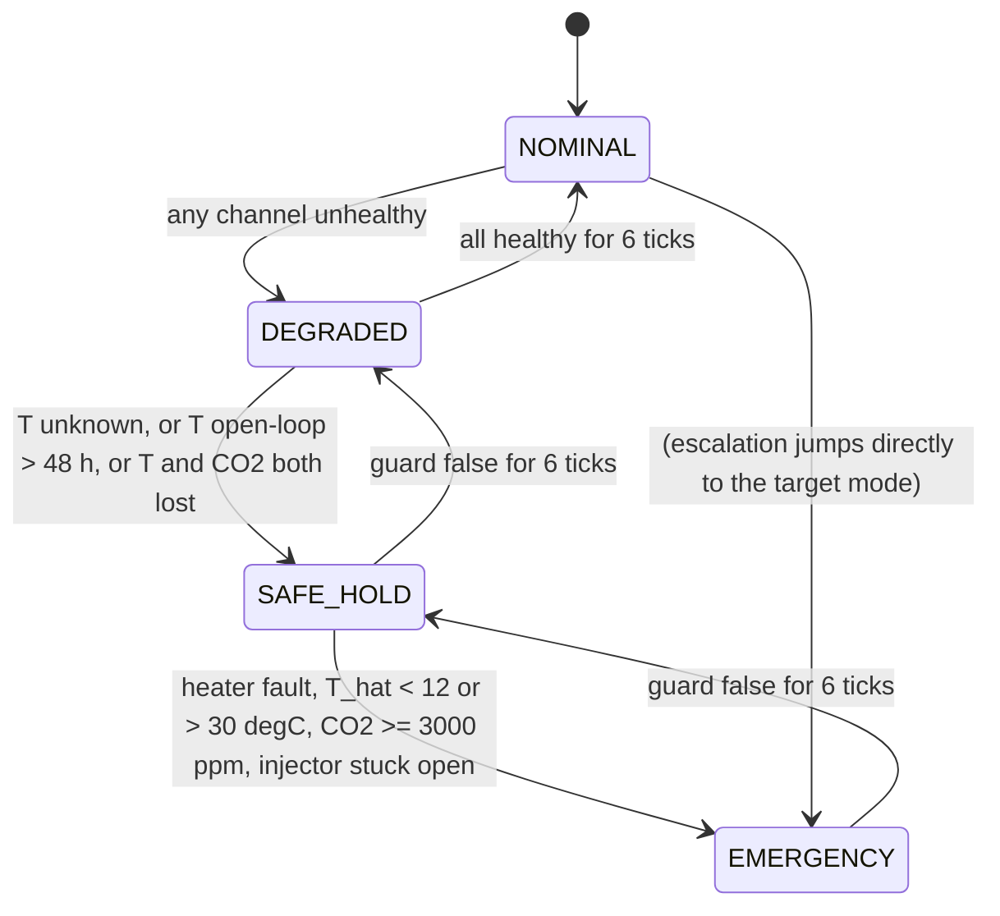

# Sensor safety requirements and fail-safe protocols

This document covers the Mars lettuce greenhouse (BioSim plant plus the Python CPS stack in this folder). It defines what the system must guarantee when a sensor or actuator fails, and the fail-safe protocols that provide those guarantees. Each requirement is written in Signal Temporal Logic (STL). The code checks it on every simulated run, and a falsification search looks for counterexamples.

| Where | What |
|---|---|
| `safety/stl.py` | Discrete-time STL with robustness semantics, plus an online runtime monitor |
| `safety/requirements.py` | The requirements below as executable STL formulas |
| `safety/failsafe.py` | `SensorGuard` (plausibility checks) and `FailSafeSupervisor` (mode automaton and protocols P1–P6) |
| `safety/harness.py` | The full closed loop with the safety stack, used by the tests and the script |
| `tests/test_stl.py`, `tests/test_failsafe.py` | Unit tests: STL semantics, guard, modes, protocols, barrier certificate |
| `tests/test_sensor_safety_requirements.py` | Requirements-based tests: 17 fault scenarios, every requirement checked |
| `scripts/sensor_safety_check.py` | Falsification: random and local search over fault schedules for rho < 0 |

## 1. Method, and where each part comes from in CSCI 513

| Course topic (Fall 2026 schedule) | Used here for |
|---|---|
| Lecture 6, Safety Requirements and LTL. Requirements versus design; hard (safety, liveness) versus soft (performance); security as a non-behavioural requirement; granularity levels (system, subsystem, function, timing) | The classification columns in section 4, and keeping the *what* (requirements) apart from the *how* (protocols, section 5) |
| Lecture 7, Signal Temporal Logic. Bounded `G`, `F`, `U`; quantitative robustness as distance to violation | Every requirement is an STL formula over the logged signals. Robustness says by how much a run passed or failed |
| Lecture 7, Testing and falsification. Input and output properties (pre-condition on inputs, post-condition on outputs); finite parameterization of input signals; minimizing robustness with random or local search | `tests/test_sensor_safety_requirements.py` (requirements-based tests) and `scripts/sensor_safety_check.py` (falsifier). Minimum detectable fault sizes are the input pre-condition (section 4.2) |
| Lecture 8, Verification I. Safety as "always stay in the good states"; invariants and inductive invariants; runtime monitors give a verdict on a finite prefix | `OnlineMonitor`; the forward-invariance check of the emergency heat law (`test_cbf_heat_makes_the_safe_set_forward_invariant`) |
| Lecture 10, Verification II. Barrier certificates as a safety invariant for continuous dynamics; over-approximation is sound for verification | The discrete control barrier function that sizes backup heating (protocol P4), checked against the worst-case exterior temperature over the tick |
| Lecture 3, Hybrid Dynamical Systems. Modes, guards, dwell, Zeno behaviour | The fail-safe supervisor is a four-mode hybrid automaton. A minimum dwell before stepping down makes every execution non-Zeno (`test_mode_switching_is_non_zeno_under_a_flickering_fault`) |
| Lectures 3–6, Control | The existing HVAC PID with feedforward is the performance controller. The supervisor is the simplex-style safety layer around it (see `csci513_cps_context.md`) |

## 2. System and sensor inventory

```
truth --> sensor layer (lag, noise, injected faults) --> model-based monitor (labels, fused values)
      --> controllers --> FailSafeSupervisor --> actuator layer (injected faults) --> plant
```

| Channel | Key | Used by | Failure modes modelled | Existing detection |
|---|---|---|---|---|
| Cabin temperature | `gh.temp_C` | HVAC (via `fused_temp_C`) | bias, drift, stuck, dropout, noise; 0.5 h lag | `AtmosphereTemperatureMonitor`: CUSUM against the thermal model |
| CO2 (NDIR) | `gh.co2_ppm` | CO2 hold | bias, drift, stuck, dropout; temperature cross-sensitivity | CUSUM against the gas mass balance |
| O2 | `gh.o2_frac` | crew/crop alarm only | bias, stuck, dropout | `SlowChannelMonitor` |
| Total pressure | `gh.pressure_kPa` | CO2 estimate (scales gas moles) | bias, stuck, dropout | `SlowChannelMonitor` |
| Root-zone level | `crop.s0.root_zone_L` | irrigation | bias, drift, stuck, dropout | `RootZoneMonitor` against `ReservoirEstimator` |
| Heater (actuator) | `cmd.heater_W` / `power.heater_draw` | cabin heat | burnout, reduced output, stuck | drawn versus commanded power |
| CO2 injector (actuator) | `cmd.co2_inject_mol` / `co2.injected_mol` | CO2 | blocked, stuck open | injected versus commanded |

## 3. Hazard analysis (sensor-caused hazards)

| ID | Failure | Hazard if nothing is done | Severity |
|---|---|---|---|
| H1 | Temperature sensor reads high (bias, stuck warm) | HVAC under-heats; cabin falls toward 7 °C at Mars night (−120 °C outside) | Crop loss |
| H2 | Temperature sensor reads low or drops out | HVAC over-heats toward 32 °C | Crop loss |
| H3 | CO2 sensor reads low or drops out | Controller injects blind and the cabin over-fills; or it stops, and the crop is starved (CO2 reached 0 ppm in the baseline) | Crop loss, crew exposure |
| H4 | Pressure sensor wrong | CO2 mole estimate is scaled wrongly, and the CO2 sensor gets blamed | Mis-diagnosis, then H3 |
| H5 | Heater fails while its sensor is healthy | Cabin reached −31.5 °C in the baseline | Crop loss |
| H6 | A controller emits NaN or an out-of-range command | Undefined actuator behaviour | Any |
| H7 | Fault flag flickers | Mode chattering; actuators toggling every tick | Wear, instability |
| H8 | CO2 injector stuck open | Concentration climbs with no software means to stop it | Crew exposure |

## 4. Requirements

Signals are 1 tick = 1 hour. `T` and the gas and level values are **truth** from the log (what really happened). Flags and modes come from the safety layer. Robustness rho > 0 means the requirement is satisfied.

### 4.1 System level: hard safety (lecture 6: "nothing bad ever happens")

| ID | Requirement | STL | Discharged by |
|---|---|---|---|
| SSR-01 | Cabin temperature stays in the crop survival band | `G[0,T] (7 <= T <= 32)` | P3, P4, P5 |
| SSR-02 | CO2 never reaches the exposure ceiling | `G[0,T] (CO2 <= 5000 ppm)` | P2; HSR-01 for H8 |
| SSR-03 | O2 and pressure stay habitable | `G[0,T] (0.195 <= O2 <= 0.235 and P >= 65 kPa)` | P1 (alarm) |
| SSR-04 | Battery keeps the life-support reserve | `G[0,T] (E >= 10 kWh)` | P4 sized to need only |
| SSR-05 | Root-zone reservoir never runs dry once primed | `F[0,24] (rz >= 2 L) and G[24,T] (rz >= 2 L)` | P1 with `RootZoneMonitor` fusion |

### 4.2 Function and timing level: detection (hard liveness, bounded)

`SSR-10..14`, one per channel (temp, co2, o2, pressure, rz):

```
G ( fault_ch -> F[0, d_kind] flag_ch ),   d_dropout = 1, d_stuck = 4, d_bias = 6, d_drift = 24 ticks
```

**Input pre-condition** (lecture 7, input/output properties): the obligation covers only faults at or above the size the sensor-plus-model noise allows anyone to see.

| Channel | min bias | min drift per tick |
|---|---|---|
| temp | 2.0 °C | 0.1 °C |
| CO2 | 150 ppm | 5 ppm |
| O2 | 0.01 | 0.001 |
| pressure | 2.0 kPa | 0.2 kPa |
| root zone | 2.0 L | 0.1 L |

Smaller faults are *tolerated*. Their effect on the plant is still bounded by SSR-01..05. The falsifier showed why this matters: without the pre-condition it "found" a 0.5 °C bias and a 0.09 ppm/tick drift. No detector can separate those from noise, so they are not real counterexamples.

### 4.3 Subsystem level: the fail-safe reaction

| ID | Kind | Requirement | STL |
|---|---|---|---|
| SSR-20 | soft | No false alarms on a healthy run | `G !flag_any` (only when no fault is injected) |
| SSR-21 | hard safety, timing | An unhealthy sensor takes the supervisor out of NOMINAL within 1 tick | `G (flag_any -> F[0,1] mode >= DEGRADED)` |
| SSR-22 | hard safety | No CO2 injection beyond replacement on an untrusted reading | `G (co2_untrusted -> u_co2 - uptake <= 0)` |
| SSR-23 | hard liveness | Heater fault: back above 15 °C within 2 h, held for 6 h | `G (heater_fault -> F[0,2] G[0,6] T >= 15)` |
| SSR-24 | security | Every applied command is finite and within its schema range | `G (for all u: u_min <= u <= u_max)` |
| SSR-25 | hard liveness | After all faults clear, return to NOMINAL within 30 h unless a new fault starts | `G (cleared -> F[0,30] (mode = NOMINAL or fault))` |
| SSR-30 | soft performance | Growth band while fault-free | `G (fault or 18 <= T <= 25)` |

### 4.4 Requirements allocated to hardware (derived)

| ID | Requirement | Why |
|---|---|---|
| HSR-01 | The CO2 injector has an independent, normally-closed isolation valve in series, driven by the supervisor's interlock | H8. A valve stuck open ignores every command, and the falsifier confirms no software protocol holds SSR-02 (16 873 ppm in simulation). Kept as a strict xfail: `test_co2_injector_stuck_open_is_contained` |
| HSR-02 | Heater output monitoring flags a loss of 5 % or more of commanded power | Found by the falsifier. A heater at 80–90 % output went unflagged at the monitor's default 0.8 ratio, the cabin cooled, and the monitor blamed the temperature sensor (SSR-23 and SSR-25 violated). `safety/harness.py` configures the monitor with 0.95 |

## 5. Fail-safe protocols

### 5.1 Sensor validation (`SensorGuard`, P1)

Each tick, each channel must pass every check to count as **healthy**:

1. present and numeric, not NaN or inf
2. inside the measurand's physical range (not the alarm band)
3. tick-to-tick change no faster than the physics allows. The check compares against the last *plausible* reading and allows k × max_step after k ticks, so one spike costs one tick, not two, and a real step change is accepted again
4. no label from the model-based monitors for that channel
5. **stale**: unhealthy for longer than `stale_ticks`

The guard keeps a last-known-good value and its age for each channel.

### 5.2 Mode automaton (`FailSafeSupervisor`)



- **Escalation is immediate.** Every tick the supervisor computes the most severe mode whose guard is true and jumps there.
- **De-escalation goes one level at a time,** after `clear_ticks` consecutive ticks below the current mode. This is the dwell-time condition: switches downward are at least 6 ticks apart, so no execution is Zeno, and a flickering flag cannot make the actuators chatter (H7).
- The guards use the best temperature estimate `T_hat`: the monitor's fused value, which falls back to its thermal model when the sensor is bad.

### 5.3 Protocols

| ID | Active | Action | Hazard |
|---|---|---|---|
| P1 | DEGRADED and above | Substitute: controllers use the fused or estimated value (the monitor already provides `fused_temp_C`, `fused_co2_ppm` and `rz.level_L`). The supervisor records why, which channel, and its LKG value and age | H1–H4 |
| P2 | Any mode | **CO2 mass-balance hold**: if the CO2 or pressure reading is untrusted, inject exactly the crop's measured uptake from last tick. That can neither raise the concentration nor starve the crop. **Interlock**: no injection when CO2 reads 2000 ppm or more. Command the injector to 0 if it is seen stuck open (and close HSR-01's valve) | H3, H4, H8 |
| P3 | SAFE_HOLD | **Model-bounded heat**: the heater command is clamped to ±150 W around the hull-loss feedforward `UA (T_set − T_ext) − 0.9 P_lamp`. With no estimate at all, the command is the feedforward itself. A wrong estimate can then neither run the heater away nor let the cabin freeze | H1, H2 |
| P4 | EMERGENCY (cold or heater fault) | **Lamps become the heater.** The heat needed is the larger of a setpoint hold and the barrier bound below. The faulty heater keeps a 600 W probe current, so the burnout stays observable (the monitor needs at least 500 W commanded) and a recovered heater shows itself. Its expected share, measured as delivered/commanded last tick, is subtracted | H5 |
| P5 | EMERGENCY (hot) | Heater off; lamps capped at the power the hull can shed at the setpoint | H2 |
| P6 | Always, last | **Sanitize**: every command is clipped into its `COMMAND_KEYS` range, and a NaN or inf command becomes its safe minimum | H6 |

### 5.4 Emergency heat as a barrier certificate (P4)

Thermal model (`thermal/model.py`), exact over one tick with constant inputs:

```
T+ = T_eq + (T - T_eq) d,     d = exp(-UA dt / C),     T_eq = T_ext + Q / UA
```

Barrier `h(T) = T − T_floor` with `T_floor = 16 °C`, and the discrete-time barrier condition `h(T+) >= (1 − gamma) h(T)` with `gamma = 0.5`. Solving for Q gives the minimum safe heat:

```
Q >= UA * ( (T_floor + (1-gamma)(T - T_floor) - d T) / (1 - d)  -  T_ext_worst )
```

`T_ext_worst` is the colder of the exterior temperature now and one tick ahead. Using the worst case over-approximates the disturbance, which is the sound direction for verification (lecture 10). When `h >= 0`, the set `{T >= T_floor}` is forward invariant (an inductive invariant: initial states are inside, and every step from inside stays inside). When `h < 0`, the distance to the floor halves every tick. `test_cbf_heat_makes_the_safe_set_forward_invariant` checks the inductive step on a grid of exterior temperatures from −121 °C to +20 °C and cabin temperatures from 16 °C to 30 °C. The guarantee is relative to the model and to having enough lamp power (15.2 kW of lamps covers the ~2 kW worst-case hull loss about 7 times over).

## 6. Results

### 6.1 Requirements-based tests (FakePlant, fault at tick 300 for 72 h)

| Scenario | Without fail-safe | With fail-safe |
|---|---|---|
| Heater burnout | T −31.5..27.1 °C; **fails SSR-01, SSR-23** | T 19.5..23.8 °C; all pass |
| Heater burnout + temperature sensor dropout | T −31.5..26.3 °C; **fails SSR-01, SSR-23** | T 19.5..23.8 °C; all pass |
| Heater at 50 % output | T 17.4..25.3 °C | T 20.7..26.9 °C; all pass |
| CO2 sensor −400 ppm bias | CO2 up to 1586 ppm; **fails SSR-22** | CO2 1137..1213 ppm; all pass |
| Pressure sensor +5 kPa bias | **fails SSR-22** | all pass |
| CO2 sensor dropout | CO2 falls to **0 ppm** (crop starves) | CO2 1136..1213 ppm (mass-balance hold) |
| Temperature bias, drift, stuck, dropout; O2 bias, stuck; pressure dropout; healthy run | pass | all pass, and the healthy run never leaves NOMINAL |

All 17 scenarios pass every applicable requirement with the fail-safe in the loop. The two "without" controls are tests too, so the fail-safe is shown to be the thing making the difference.

### 6.2 Falsification (`scripts/sensor_safety_check.py`, 150 random + 20 local samples per seed)

- **Fail-safe off:** 95 counterexamples on seed 1. The worst is a heater burnout with the cabin at −40 °C (SSR-01 rho = −47.8).
- **Fail-safe on, seeds 1, 3, 4:** no counterexample.
- **Fail-safe on, seed 2:** 19 counterexamples, all the same case: a temperature-sensor bias during a heater fault. SSR-01 still holds in every one. This is finding F-3 below.

### 6.3 Findings and open items

| ID | Finding | Status |
|---|---|---|
| F-1 | Injector stuck open cannot be contained in software | HSR-01 (hardware). Strict xfail test |
| F-2 | Heater degradation of 10–20 % went undetected and the temperature sensor was blamed | Fixed by configuration (HSR-02, ratio 0.95) |
| F-3 | A temperature sensor bias that starts during a heater burnout is never flagged: `AtmosphereTemperatureMonitor` skips its temperature bias test while it reports `heater_burnout`. Cabin survival (SSR-01) still holds | Open. Needs a monitor change in `estimators/thermal.py`. Strict xfail: `test_temperature_bias_during_heater_burnout_is_detected` |
| F-4 | Everything above is on FakePlant with the Python thermal model. Not yet run against live BioSim (`--live`) | Open |

## 7. Running it

```bash
cd mars_simulation
pytest                                            # all offline tests, including these
pytest tests/test_sensor_safety_requirements.py   # requirements-based tests only
python scripts/sensor_safety_check.py -n 150 --seed 1
python scripts/sensor_safety_check.py -n 150 --seed 1 --no-failsafe
```

To use the fail-safe in your own run:

```python
from estimators import AtmosphereTemperatureMonitor, MonitorInLoop
from safety import FailSafeSupervisor
from safety.requirements import evaluate, report

fs = FailSafeSupervisor()
loop = MonitorInLoop(AtmosphereTemperatureMonitor(heater_degraded_ratio=0.95), inner_supervisor=fs)
run(plant, controllers, n, sensor_layer=chain_sensor_layers(AtmosphereSensorLayer(), loop.sensor_layer),
    supervisor=loop.supervisor, logger=log)
print(report(evaluate(log.records, fs)))
```

`FailSafeSupervisor(inner_supervisor=...)` wraps any other supervisor (for example `PowerBudgetSupervisor`). Its emergency heat runs after the inner supervisor, so survival heat takes priority over the power budget's allocation. SSR-04 checks the battery reserve independently.
